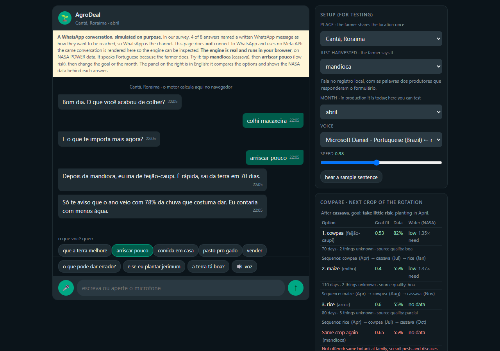
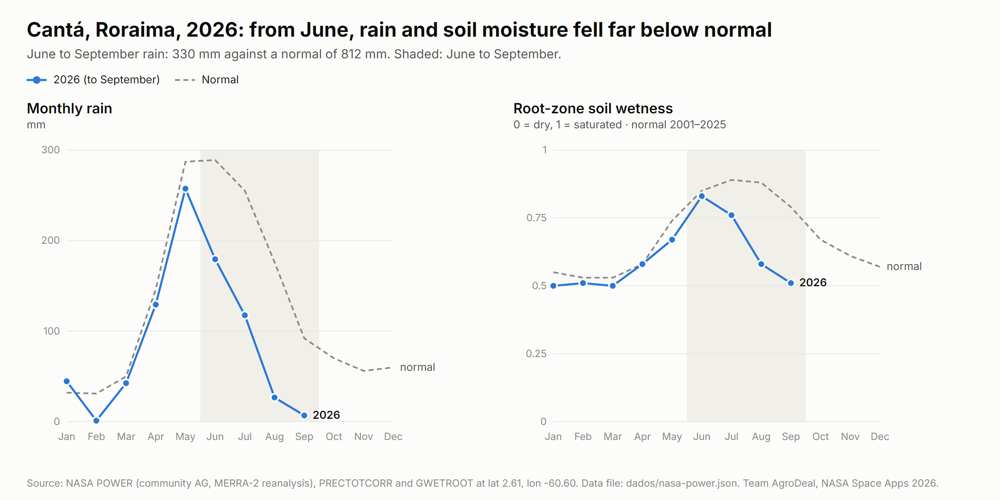

# AgroDeal: What do I plant next?

**NASA Space Apps Challenge 2026 · Field Shift: Adapting Farms with NASA Data**
Team AgroDeal: Welder Barroso and Giuliano França · Boa Vista, Roraima, Brazil

**Try it:** https://welderbm.github.io/NASA-SPACE-APPS-2026-BVB-Welder/
**Pitch (7 slides, PDF):** https://drive.google.com/file/d/1mXxqji7_W0kXJdyb5uGGjR-FCtwWLdYl/view
**License:** Apache-2.0

A conversation for small farmers in Roraima, in the Brazilian Amazon, who must decide
what to plant right after a harvest. The farmer says what was just harvested and picks
what matters most: better soil, low risk, food at home or pasture. The answer compares
options with NASA POWER rain and soil moisture, crop traits and the official planting
calendar, says why, and says what it could not measure.



---

## In 60 seconds

1. Open the demo. The chat is in Brazilian Portuguese, the farmer's language; the side
   panels are in English.
2. Tap **mandioca** (cassava), then **arriscar pouco** (take little risk).
3. Read the **Compare** panel: the top three next crops, side by side with planting the
   same crop again, each with goal fit, how much of the goal could be measured, the NASA
   water risk, cycle length and what is unknown, plus a three-crop **sequence** for
   each: the engine re-runs in the month the previous crop leaves the ground.
4. Change the goal (**que a terra melhore**, better soil) or the **Month**: the order
   and the reasons change. Tap **vender** (sell): it says it has no price or buyer data.
5. Switch **Place** to Rio Verde, Goiás: same code, other data, a different answer.

## Why

- In 2026 the El Niño hit Roraima. At our point in Cantá (lat 2.61, lon -60.60), NASA
  POWER shows 330 mm of rain from June to September, against a 1981–2026 mean of
  859 mm (−62%, the lowest since 1981). In September, root-zone soil moisture was 0.51
  against a 2001–2025 normal of 0.79.



- 87% of Roraima's 16,850 farm establishments had no technical assistance (IBGE 2017,
  cited by the state extension agency IATER in 2024).
- Most crop rotation tools optimize profit for large farms. This one lets the small
  farmer choose what to optimize, and sits beside Brazil's official planting-risk zoning
  (ZARC), not instead of it.

## How it works

A deterministic engine (`motor/cerne.js` in the browser, `motor/cerne.py` as the
reference) takes the harvest, the goal, the place and the month, and returns
**three numbers that are never mixed into one score**:

| Number | What it uses |
| --- | --- |
| **Risk** | NASA POWER: the rain the crop's growing window normally gets, scaled by how the last three months compared to normal (a persistence heuristic, not a forecast), against the crop's water need; the typical longest dry spell; root-zone soil moisture against the monthly normal |
| **Fit** | Crop traits only: nitrogen fixation, residue, drought tolerance, cycle length, whether it can wait in the field, whether it is forage, and the official ZARC planting window. Each goal weighs them differently |
| **Confidence** | The share of the goal's criteria we could actually measure for that crop. Below 50%, a crop cannot take the top spot |

- **Rotation rule:** the next crop is never from the same botanical family as the one
  just harvested, because a different family is less likely to carry the same soil
  pests and diseases. It is a simplification; the extension agent knows the exceptions.
- **The NASA water risk changes the ranking when the farmer wants to take little risk.**
  Options whose water risk is high, or whose water need we cannot check, go below the
  others. In a dry month when every option is in that situation, the bot says so first
  when asked "what could go wrong?". Under the other goals the water risk is shown beside
  each option and spoken on request, without reordering.
- **Places are data, not code.** Each place (`dados/local-*.json`) carries its crop
  list, planting windows and wording. Same maize: April in Cantá gets 686 mm of adjusted
  rain against 500 mm needed (low risk); September in Rio Verde gets 386 mm (high risk).
- **No AI model runs in the demo.** Understanding is keyword matching, every number
  comes from the engine over named data, and the sentences are fixed templates written
  with farmers' own words.

## NASA data: satellite, model and ground

`dados/nasa-power.json` holds monthly NASA POWER (community AG) series for both places:
precipitation (PRECTOTCORR), soil wetness at surface, root zone and profile (GWETTOP,
GWETROOT, GWETPROF), soil and air temperature, and the dry-spell length derived from the daily
series. POWER values are **gridded estimates (about 50 km) from the MERRA-2 reanalysis**,
which assimilates satellite and ground observations. They are not measurements on the
farm. The farmer's own eye on the soil and the extension agent stay the ground truth;
the tool gives them the regional picture.

## Honest limits

| Limit | What the bot does today |
| --- | --- |
| Sequences are chained one-step choices, not optimized as a whole | Shows a three-crop sequence per option, each step recomputed with that month's NASA data |
| NASA water risk reorders only under the low-risk goal | Shows it beside each option under the other goals |
| "Soil" is soil moisture only; no texture, fertility or organic matter | Says so in the limits; soil texture from the farmer or SoilGrids is a next step |
| Water need known for 3 of 14 crops; 5 crops without cycle length | Says "I don't know how much water it needs" and crosses the rest |
| Official ZARC window loaded for cowpea only | Where loaded it changes the answer: cowpea low-risk fit goes from 0.53 in April to 0.87 in July |
| No prices, buyers, labor or machinery data | Says it has no data and asks for a goal it can measure |
| Small field research: 8 survey answers in Roraima, 1 interview in Goiás | Wording comes from those answers; field validation with IATER is a next step |
| NASA POWER download script is not in the repository | The JSON records source, parameters and date |

## Reproduce

```bash
# demo locally (the page fetches dados/*.json, so it needs a server)
python -m http.server 8000      # then open http://localhost:8000

# tests (Python 3 and Node.js)
python motor/invariantes.py     # honesty invariants over 3,156 cases (all six goals)
python motor/conformidade.py    # Python and JavaScript engines answer the same in all 3,156 cases
```

## Repository map

| Path | What it is |
| --- | --- |
| `index.html` | The demo: chat, Compare panel, data panel. Runs the engine in the browser |
| `motor/` | Engine (`cerne.js`, `cerne.py`) and the two test suites |
| `dados/` | NASA POWER series, crop table with source and quality per field, goals, place layers |
| `entregas/` | Pitch deck (PDF and HTML sources), pitch videos, submission copy |
| `docs/` | Internal working notes, in Portuguese: research, decisions, data checks |
| `README.pt-BR.md` | The team's working README, in Portuguese |

## Next steps

A water-risk weight for every goal, not only low risk; optimizing whole sequences instead of chaining one-step choices; soil
texture from the farmer or SoilGrids; the remaining official ZARC windows; a WhatsApp
adapter on the same engine; a field test with Roraima farmers and IATER extension agents.

## Use of AI

Team AgroDeal (Welder Barroso and Giuliano França) made the product decisions, ran the
survey and the interview, checked the sources and reviewed every output. We used Claude
(Anthropic) to write and review most of the code, research and check sources, and draft
the documentation, slides text and submission; most commits are authored by Claude for
that reason. The project logo was generated with an AI image tool and is marked as such.
The pitch videos use an AI voice (Kokoro TTS) and carry a visible AI-generated watermark.

## Sources

NASA POWER (power.larc.nasa.gov) · MERRA-2 (NASA GMAO) · FAO ECOCROP (OpenCLIM copy) ·
ZARC, Brazil's Ministry of Agriculture · Embrapa Roraima · IBGE Agricultural Census 2017
via IATER Roraima · Folha BV · Schöning et al. (2023). Full list with links:
`entregas/docs/formulario-submissao.md` and `docs/08-fontes.md`.
